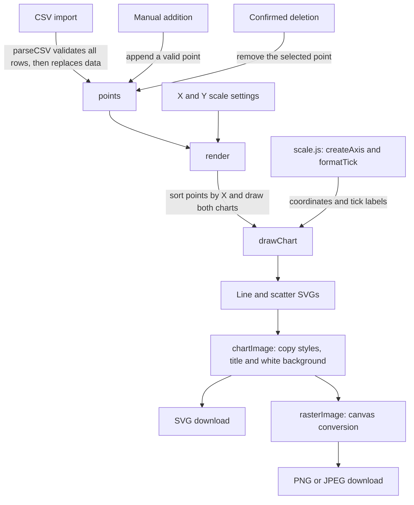

# Warm-Up-Graphing-Tool

A small, dependency-free CSV and XML plotting website with linked line and scatter plots.
Open `index.html` in a browser, or serve this folder with any static web server.

## Quick start

1. Clone or download this repository and open its folder. No install or build step is needed.
2. Open `index.html` directly in a browser. Click **Import CSV** and select `sample.csv`
   from the same folder. Both charts should show six points, from `(1,3)` to `(6,10)`.
3. To run the unit tests, install Node.js 24, open a terminal in the repository root,
   and run `node --test tests/*.test.cjs`.

These steps were verified from a fresh checkout with Node.js **v24.22.1** and
Microsoft Edge on Windows, including opening the page through a local `file:` URL.

## Use

- Import a CSV with the header `x,y` and two finite numbers per row.
- Import an XML file whose root contains `<point>` elements. Each point gives `x` and `y` either as attributes or as child elements (see `sample.xml`); both forms may be mixed in one file:

  ```xml
  <points>
    <point x="1" y="3"/>
    <point><x>2</x><y>5</y></point>
  </points>
  ```

  Every point must have exactly one numeric `x` and `y`. A malformed file or invalid point is rejected and the current data is kept.
- The imported file is the only source of data, points can't be added or deleted on the page. To change the data, edit the file and import it again.
- Hover or focus a point to see its original values.
- Uncheck **Show data points** above the line graph to see the line without markers. The scatter plot keeps its points, and exported images use the current visibility setting.
- Pick **Data color** to recolor the line and the points in both charts. The choice persists across imports and scale changes, and applies to PNG, JPEG, and SVG exports. Refreshing restores the default blue. The current CSV format supports one data series; per-series color controls will be needed when multiple-column plotting is added.
- Switch X and Y independently between linear and base-10 logarithmic scales. Log scale spreads out values across orders of magnitude.
- An axis containing zero or negative values stays linear; the page explains why its log button is disabled. Importing such values resets that axis to linear without removing any points. The other axis keeps its selected scale.
- Type X- and Y-axis labels to replace the default X and Y on both charts and in exported images. Blank labels fall back to X and Y.
- Choose PNG, JPEG, or SVG below either chart and click **Export image**. The download includes the chart title, current scales, labels, and points on a white background. PNG and JPEG are 960 by 664 pixels; SVG remains scalable.

All processing and image exports happen locally in the browser. Refreshing clears the data.
Scientific notation is accepted. Tick labels remain finite for very large values, and very small or constant datasets keep valid coordinates.

## How plotting works



Start in `app.js` for input handlers, the shared `points` array, `render()`,
`drawChart()`, and export. Use `scale.js` for axis calculations and tick labels.
`render()` also resets unsupported log scales and updates the controls before
drawing. An invalid CSV leaves the current data unchanged; canceling deletion
does not change `points`.

`tests/scale.test.cjs` checks numerical helpers without opening a browser.
The shared test command also discovers other `tests/*.test.cjs` files as they
are added. It does not verify file input, chart interactions, or downloads.
Check those separately in the browser: import `sample.csv`, add a point,
cancel and confirm deletion, toggle a scale, and export an image.

## Files

- `index.html`: page controls and chart containers.
- `style.css`: layout and chart appearance.
- `scale.js`: numeric scaling and tick formatting.
- `app.js`: CSV and XML input, chart interactions, and image export.
- `sample.csv`, `sample.xml`: the same example dataset in each format.
- `test-data/`: a larger growth dataset in both formats.

## Numeric regression checks

With Node.js 24 installed, run `node --test tests/*.test.cjs` from the repository root.
No dependencies or build step are required to use the website.

GitHub Actions runs the same command when pull requests are opened or updated and
when commits are pushed to `main`. Open a pull request's **Checks** tab, or the
repository's **Actions** tab and its **Node tests** workflow, to see results and
failure details. Tests must pass before merging.
