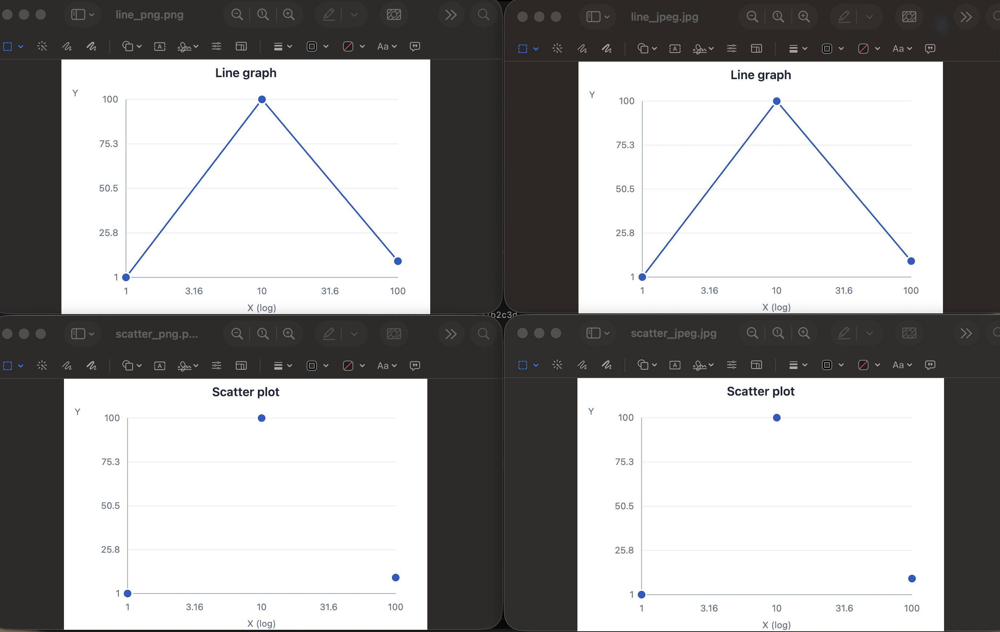

# Export Validation Results

This document records the manual export checks for the graphing tool.

## Test Environment

- Browser: `Google Chrome 154.0.8037.59`
- Application commit: `1dcbbdd`
- Operating system: macOS

## Test Data

The following CSV was used for all six export checks:

```text
x,y
1,1
10,100
100,10
```

## Chart Configuration

The same configuration was used for all exports:

- X-axis: logarithmic
- Y-axis: linear

## Results

| Chart | Format | Opens | Title | X-axis (log) | Y-axis | Correct data points | White BG | Dimensions | Discrepancies |
| --- | --- | --- | --- | --- | --- | --- | --- | --- | --- |
| Line graph | PNG | Pass | Pass | Pass | Pass | Pass | Pass | 960 × 664 | None |
| Line graph | JPEG | Pass | Pass | Pass | Pass | Pass | Pass | 960 × 664 | None |
| Line graph | SVG | Pass | Pass | Pass | Pass | Pass | Pass | N/A | None |
| Scatter plot | PNG | Pass | Pass | Pass | Pass | Pass | Pass | 960 × 664 | None |
| Scatter plot | JPEG | Pass | Pass | Pass | Pass | Pass | Pass | 960 × 664 | None |
| Scatter plot | SVG | Pass | Pass | Pass | Pass | Pass | Pass | N/A | None |

## Checks Performed

For each exported file, I checked that:

- The file opened successfully outside of the application.
- The chart title was correct.
- The X-axis was labeled `X (log)`.
- The Y-axis was labeled `Y`.
- All three data points were displayed correctly.
- The background was white.
- Line graph exports included the connecting line.
- Scatter plot exports matched the scatter plot shown in the application.
- PNG and JPEG exports were 960 × 664 pixels.

## Result

All six exports passed the manual validation checks with no discrepancies found.

## Representative Screenshot

