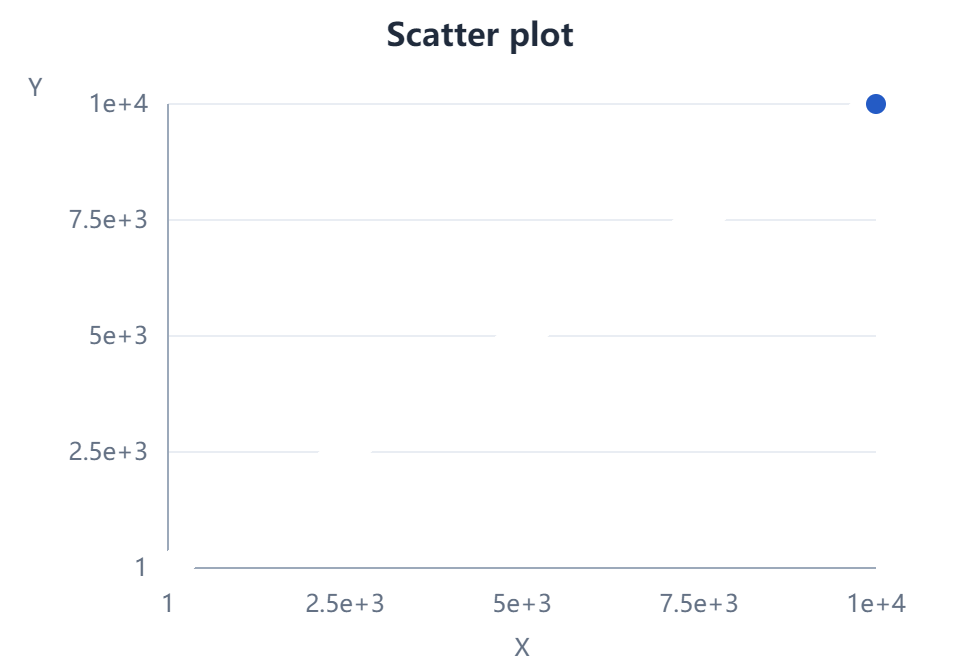
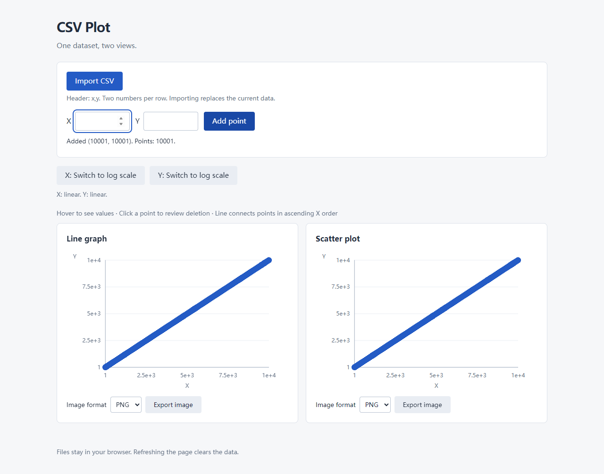

# Exploratory performance measurements

Related issue: [#11 (title: Issue 9)](https://github.com/Caffeinated-Coders-CSE-210/Warm-Up-Graphing-Tool/issues/11).
Measured on October 26, 2026 at 15:45 PDT (22:45 UTC).

## Findings and recommendation

All 27 measured operations completed: 3 sizes × 3 repetitions × import/add/export.
No page errors, failed downloads, or timeouts occurred. At 10,000 input points,
import took 182.6–185.7 ms, adding one point took 183.4–220.7 ms, and scatter PNG
download availability took 256.9–270.2 ms on this machine.

**There is a visual problem even when the data and coordinates are complete.**
With 1,000 and 10,000 evenly spaced diagonal points, the white marker outlines
obscure earlier blue markers and the line beneath them. The charts and PNG can
look almost empty except for the final point. This needs a focused rendering
follow-up; faster completion alone would not make the output useful.

Recommendation: occasional operations on these sizes complete promptly on the
tested desktop, but do not advertise a supported capacity or impose a hard row
limit from three measurements. Prioritize the dense-marker visibility problem.
For frequent interaction around 10,000 points, profile `render()`/`drawChart()`
before changing the rendering strategy: adding a single point still rebuilds
both charts, and frame callbacks were delayed by up to 197.6 ms. Consider marker
styling/size or aggregation with reviewer input, then repeat these measurements.
No application optimization or visual fix is included in this investigation.

## Environment

| Item | Value |
| --- | --- |
| Application commit | `3895343d0673aa7af7930b641a17b9afe649403b` |
| OS | Windows, kernel `10.0.26300`, x64 |
| CPU | Intel Core i7-11800H @ 2.30 GHz; 16 logical processors |
| RAM | 31.9 GiB |
| Browser | Microsoft Edge `156.0.4314.42`, Chromium engine, headless |
| Automation | Playwright `1.62.1`, Node.js `v24.22.1` |
| Page | Direct local `file:` URL for `index.html` |
| Viewport | 1280 × 960, device scale factor 1 |
| Axis settings | X linear; Y linear |

No CPU or network throttling was configured. This is one desktop/browser run,
not a cross-device capacity guarantee or a human usability study.

## Method

The [measurement script](../../scripts/measure-performance.cjs) generates actual
CSV files with `x,y` followed by `(i,i)` for `i = 1..N`, for N = 100, 1,000,
and 10,000. Files, all nine PNG downloads, screenshots, and raw JSON are written
to the selected output folder; the generated CSV files are not checked in.

One browser process is reused. Each repetition starts with a fresh browser
context/page, imports the corresponding CSV through the real file input, adds
`(N+1,N+1)` through the form, then exports the scatter plot as PNG. Export thus
contains **N+1 points**. Sizes run in ascending order, with three repetitions per
size. There is no discarded warm-up or outlier. Browser startup and page loading
are outside the measured intervals; process/JIT/OS cache effects are not reset.

- **Import:** `performance.now()` from the input's captured `change` event to
  two animation-frame callbacks after the application's successful import status.
  This includes file reading, parsing, updating both SVGs, and a paint opportunity.
- **Add:** the same clock from the form's captured `submit` event to two animation
  frames after the success status. Input typing is excluded; both charts update.
- **Export:** the clock starts at the scatter export button's captured `click`.
  On Playwright's `download` event, the runner reads the browser clock. This is
  download availability, not disk-save time, and includes notification/protocol
  round-trip overhead. `saveAs()` and file verification happen afterward.
- **Responsiveness:** a separate animation-frame loop records the longest callback
  gap during each operation, including the initial wait from the input event.
  This is a scheduling/stall indicator, not an FPS measurement or proof of a
  human-visible freeze. Two animation frames are a paint-opportunity proxy, not
  a measurement of the exact moment every pixel reaches a physical display.

Instrumentation observes events/status and does not replace the parser,
renderer, or export functions. Detailed point/coordinate assertions and screenshots
run outside the timed intervals. The [raw JSON](performance-measurements.json)
also includes `statusMs` (DOM/status completion), `twoFramesMs`, maximum frame
gaps, PNG sizes, point counts, and page errors. All times below are milliseconds.

## All measurements

| Input points | Run | Import + charts | Add + charts | PNG available | Observed problems |
| ---: | ---: | ---: | ---: | ---: | --- |
| 100 | 1 | 71.5 | 74.0 | 37.4 | First-run scheduling delay; no operation failure |
| 100 | 2 | 12.5 | 8.0 | 20.4 | No operation failure |
| 100 | 3 | 12.6 | 8.2 | 19.5 | No operation failure |
| 1,000 | 1 | 29.7 | 20.5 | 41.1 | Dense markers visually obscured |
| 1,000 | 2 | 30.0 | 21.5 | 43.5 | No operation failure; same dense dataset |
| 1,000 | 3 | 29.9 | 19.7 | 44.3 | No operation failure; same dense dataset |
| 10,000 | 1 | 184.4 | 185.4 | 270.2 | Dense markers obscured; callback gaps >100 ms |
| 10,000 | 2 | 185.7 | 183.4 | 257.0 | No operation failure; callback gaps >100 ms |
| 10,000 | 3 | 182.6 | 220.7 | 256.9 | No operation failure; add callback gap 197.6 ms |

| Input points | Median import | Median add | Median export | Maximum callback gap: import / add / export |
| ---: | ---: | ---: | ---: | --- |
| 100 | 12.6 | 8.2 | 20.4 | 67.9 / 67.2 / 11.2 |
| 1,000 | 29.9 | 20.5 | 43.5 | 16.8 / 18.6 / 14.0 |
| 10,000 | 184.4 | 185.4 | 257.0 | 117.4 / 197.6 / 118.9 |

The first 100-point trial is retained: its import/add status updates took only
4.3/3.4 ms, but the frame-based completion measurements were 71.5/74.0 ms.
This shows scheduling variability in the measurement, not a demonstrated slow
CSV parser. The experiment does not isolate the cause of that first-run delay.

## Correctness and visual observations

After every import and addition, the runner verifies all point counts, accessible
X/Y values, finite coordinates, and expected linear positions in **both** charts,
plus the line polyline vertex count. All checks passed. All nine downloads had
PNG signatures and dimensions 960 × 664. End-state screenshots from repetition 1
at each size and the 10,000-point export were visually inspected. These checks
establish completed DOM updates/downloads; they do not make obscured data legible.

No persistent hang or timeout was observed. At 10,000 points the callback gaps
above indicate brief stalls. With 1,000 and 10,000 points the charts look
incomplete, although their elements/values are present. The largest exported PNG
has the same appearance:



The existing `.point` rule in `style.css` uses `stroke: white; stroke-width: 2`.
As a separate, **untimed diagnostic only**, opening the 10,000-point dataset,
adding `(10001,10001)`, and temporarily injecting `.point { stroke: none; }`
in an isolated page made the blue diagonal visible while preserving all 10,001
points. This supports marker overlap/occlusion as the explanation rather than
lost data. The override was not applied to the repository or any timed run.



To reproduce the visible problem, open `index.html`, import the generated
`points-1000.csv` or `points-10000.csv`, keep both scales linear, add the next
diagonal point, and export scatter PNG. Expect the dense diagonal to remain
visually represented; observe the nearly blank white diagonal and last blue point.

## Reproduce the measurements

From the repository root on Windows with Node.js and Microsoft Edge installed,
use PowerShell. Install the optional runner dependency outside the repository:

```powershell
$perfDeps = Join-Path $env:TEMP 'graphing-performance-deps'
npm.cmd install --prefix "$perfDeps" --no-save --package-lock=false playwright@1.62.1
$env:NODE_PATH = Join-Path $perfDeps 'node_modules'
$env:BROWSER_CHANNEL = 'msedge'
node scripts/measure-performance.cjs "$env:TEMP/graphing-performance-results"
```

The browser runs headlessly in isolated contexts. Keep the output folder outside
the repository. Reusing an output folder overwrites its generated result files;
choose a new folder to preserve earlier runs. The application itself still needs
no dependencies or build step. The script uses installed Edge by default; an
installed Chrome can be selected with `BROWSER_CHANNEL=chrome`, but measurements
from a different browser should be recorded as a separate environment.

Existing numerical/parser regression checks also passed: `node --test tests/*.test.cjs`
(22/22). This script is an optional exploratory tool, not a timing threshold added
to CI. A teammate should review the method, observations, and recommendation
before merging the associated PR.
